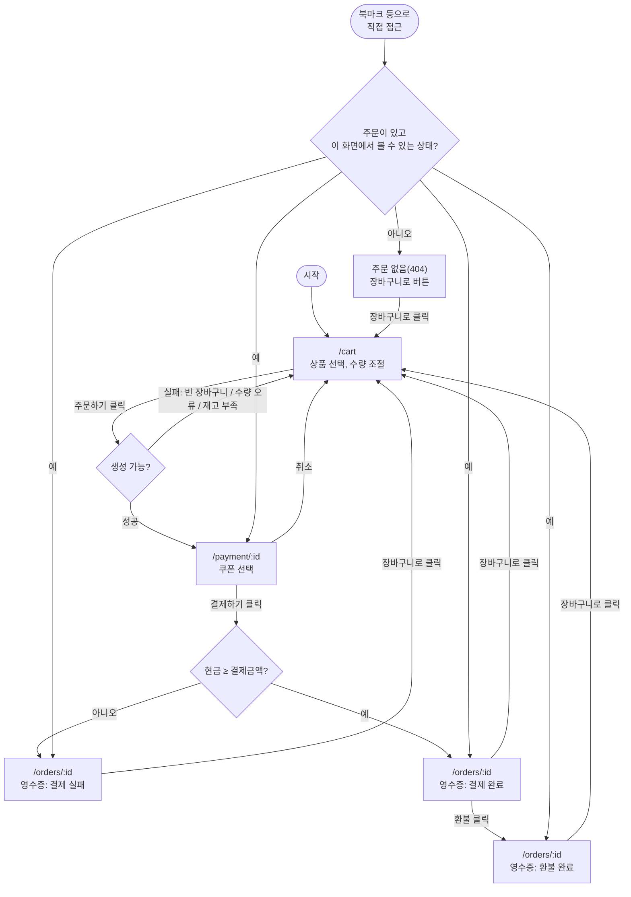

# 사용자 플로우

Oct 6, 2026 · @DevYoung

화면과 사용자 행동, 분기, 상태별로 보이는 화면만 다룬다. 화면 배치는 [wireframe.md](./wireframe.md)를 따른다. 진입 시 판정 방법과 화면 이동 구현은 설계에서 다룬다.

## 플로우

## 분기 이유

| 분기 | 이유 |
| --- | --- |
| 생성 실패 시 `/cart`에 머무름 | 주문이 안 생겼으니 이동할 다음 화면이 없음. 실패 이유는 오류 안내 토스트로 보여줌 |
| 취소 시 `/cart`로 돌아감(영수증 없음) | 결제 시도 자체가 없었던 거라 보여줄 이력이 없음 |
| 결제 실패도 `/orders/:id`로 이동(영수증 있음) | 결제를 "시도"한 이력이라 실패 이유와 함께 남김 |
| 직접 접근 시 볼 수 없는 주문이면 자동 리다이렉트 대신 404 화면 | 탭을 닫으면 주문 데이터가 사라져서 북마크 재진입 시 주문이 없을 수 있음. 표시 규칙은 아래 [화면 표시 규칙](#화면-표시-규칙) |

## 화면 표시 규칙

`/payment/:id`, `/orders/:id`는 주문 상태가 아래 "화면 표시"에 해당할 때만 그 라우트 화면을 보여준다. 나머지는 같은 URL 자리에서 주문 없음(404) 화면을 보여준다([wireframe.md](./wireframe.md#주문-없음404)).

| 라우트 | 화면 표시 | 404 |
| --- | --- | --- |
| `/payment/:id` | 결제 대기 | 주문 없음, 그 외 모든 상태 |
| `/orders/:id` | 결제 완료, 결제 실패, 환불 완료 | 주문 없음, 결제 대기, 주문 취소 |

주문 취소가 404인 이유는 취소 분기와 같다 — 결제 시도 자체가 없었던 주문이라 보여줄 영수증이 없다.
